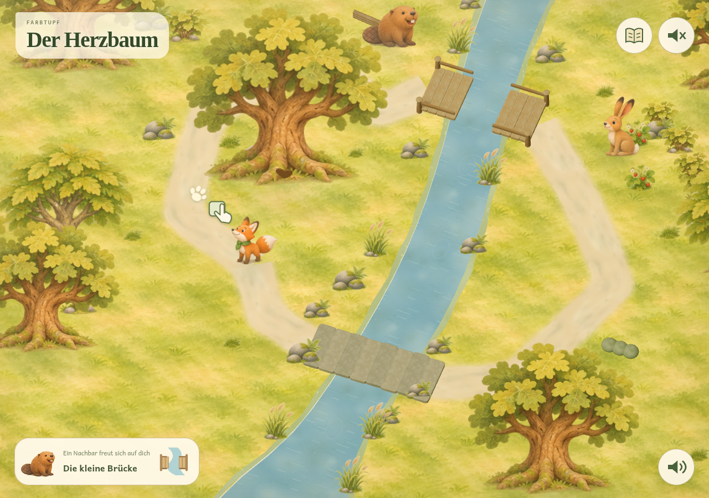

# Farbtupf design

**Selected direction: original A, Painted woodland.** A Swiss-native woodland,
a fox companion, short complete quests and picture-led play for a 6–7-year-old
who initially cannot read. The current app has an explorable, solid 3D world
and animated story scenes, with original painted portraits and flat illustrated
puzzles. [Exploration update 6.6](../docs/EXPLORATION.md).

| Current design | Open |
| --- | --- |
| Selected art direction and its original reference | [Art direction](heart-tree/ART-DIRECTION.md) |
| Selected-style studies and earlier implementation screenshots | [Current visual gallery](heart-tree/GALLERY.md) |
| Story, world and gameplay | [Heart Tree design pack](heart-tree/README.md) · [Blueprint](heart-tree/BLUEPRINT.md) |
| Picture-led controls, speech and demonstrations | [Child interface](heart-tree/CHILD-INTERFACE.md) · [Before reading](heart-tree/BEFORE-READING.md) |
| Implemented story, controls and saving | [Current app notes](../docs/HEART-TREE.md) |
| Shared production artwork | [Artwork and atlas notes](../assets/woodland/ART-NOTES.md) |

## Design documents

- [Picture-only walkthrough cards](heart-tree/walkthrough-cards.pdf)
- [Walkthrough overview](heart-tree/walkthrough-preview.pdf)
- [First-session guidance and observation sheet](heart-tree/FIRST-SESSION.md)
- [Activity guidance matrix](heart-tree/ACTIVITY-READINESS.md)
- [Original illustrated design review PDF — historical](../../../design/archive/reviews/DESIGN-REVIEW.pdf)

## The learning and drawing app

- [Selected Waldatelier identity](waldatelier/01-waldatelier.png) and
  [implementation notes](waldatelier/README.md)
- [Waldentdeckungen flat puzzle designs](waldentdeckungen/README.md)
- [Learning concept](../docs/LEARNING.md) · [Learning ideas document](../docs/lernideen.html)
- [Curriculum and handwriting research](../docs/RESEARCH.md)
- [LMVZ research](../docs/LMVZ-RESEARCH.md) · [Activity resource mapping](../docs/RESOURCE-RESEARCH.md)
- [Timer behaviour](../docs/TIMER.md) · [Preview notes](../docs/PREVIEW.md)

## Archive

[Dismissed alternatives and earlier work](../../../design/archive/README.md) are kept separately:
unused visual identities, woodland refinements, mixed option boards, earlier
storyboards, prototype screenshots, historical review packets and build notes.
The archive retains the original images, PDFs and document-authoring sources.

[Back to the app README](../README.md)
