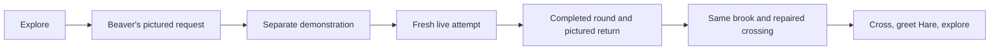

# Opening quest — help, leaving and return states

> Design reference recorded during planning. Implementation and approval statements describe the stage when it was written. See the [current app notes](../../docs/HEART-TREE.md) and [design index](../README.md) for the present build.

Picture-led interaction design for a child aged 6–7 who initially cannot read. The [first local slice](../../../../design/archive/implementation-notes/PLAYABLE-SLICE.md) implements these opening routes for the existing pattern activity. Broader activity adaptation and child observation remain future work.

[Optional-route storyboard](opening-support.png) · [Main walkthrough](painted-woodland-opening.png) · [Opening layout](OPENING-LAYOUT.md)

## 1. The normal route

The illustrated pattern is a guidance example, not a final choice of first activity or a new question bank. One existing activity round may contain several items. A single pictured answer is not automatically a complete round or a new star.

## 2. Controls and taught meanings

| Control | Intended action | How its meaning is introduced |
| --- | --- | --- |
| Neighbour or request picture | Approach, hear the request and choose to help | Resident gesture, meaningful bridge picture and one short spoken request |
| Speaker | Repeat the current instruction | Show its use in the introductory guidance; replay does not indicate the live answer |
| Hand acting on a sample card | Watch the separate demonstration again | Demonstrate this control when introducing help; return to the unfinished attempt afterwards |
| Beaver/brook scene picture during a task | Leave to the same safe forest place | Introduce the destination through the picture and short voice; no confirmation dialog is needed |
| Large Beaver/brook picture after success | Return to see the story result | Picture is the primary next action, accompanied by “Zurück zum Biber.” |

Use generous pictured targets and stable positions. The symbols on the board are draft controls whose meanings need demonstration and observation. Introduce support in context; a long compulsory control tour should not delay the first useful action.

## 3. State behaviour

| State or event | Visible response | Progress and next state |
| --- | --- | --- |
| Arrive | Fox, one reachable path spot and a movement gesture | First touch enables the planned short speech where audio is available; then normal walking |
| Tap Beaver | Fox approaches and Beaver shows the bridge goal | One opening request, with no duplicate run from repeated taps |
| Visit Hare first | Hare points towards Beaver and the crossing | Beaver picture guides to the same request; no second introductory quest |
| Accept request | A separate flat example teaches the rule and action | Save the quest/activity context and safe brook return place |
| Start attempt | Fresh equivalent item, with no demonstration answer cues | Use the chosen activity level independently of reading support |
| Hear again | Repeat instruction only | Keep the current item and choices unchanged; no help penalty |
| Watch again | Park the live attempt and show a different example | Resume the same live item within the current supported session; remove demo arrows/hand cues on return |
| Incorrect answer | Brief calm feedback and another opportunity under the activity's rules | Preserve completed contributions; adapt support without treating a reading problem as subject failure |
| Quiet pause | Leave time for thinking | No timer, unsolicited answer or repeated instruction solely because the child is quiet |
| Leave before completion | Return beside Beaver, bridge still unfinished | Preserve completed rounds/quests and level; mark the request available to continue |
| Continue | One familiar Beaver/activity preview re-enters the same request | Restore the activity snapshot where supported; otherwise use a fresh equivalent item at the same level |
| Complete the current round | A quiet result and large pictured return | Save successful contribution and durable world result once, independently of new stars |
| Return after success | Same location and camera; repaired bridge and Beaver's short gesture | Show the payoff, let the child walk across and greet Hare |
| Revisit later | Repaired bridge remains usable | Optional activity/practice routes do not repeat or undo the first repair |

## 4. Help and leaving are separate

Help stays inside the learning session. The speaker repeats what to do; the hand/sample control replays a separate example. The live attempt must not inherit a highlighted correct choice, arrow or ghost answer. Instruction audio remains separate from speaking a reading target in later reading activities.

Leaving returns to the forest immediately through the place picture. It is reversible, so it does not require a written confirmation or an extra choice. The neighbour remains welcoming. A later visit offers one clear way to continue the unfinished request.

Returning after success uses the same destination picture more prominently. The child learns a stable meaning: this picture leads back to Beaver. Successful return also reveals the lasting world change.

## 5. Draft Swiss Standard German lines

| Moment | Short spoken line |
| --- | --- |
| First movement | “Tippe auf den Weg.” |
| Beaver's request | “Die Brücke ist noch nicht fertig. Hilfst du mir?” |
| Hare first | “Der Biber braucht Hilfe bei der Brücke.” |
| Postpone | “Ich bin hier, wenn du magst.” |
| Speaker teaching | “Hier hörst du es noch einmal.” |
| Demonstration teaching | “Hier zeige ich es dir noch einmal.” |
| Fresh attempt | “Jetzt du. Wie geht es weiter?” |
| Another attempt | “Schau noch einmal.” |
| Leave or successful return | “Zurück zum Biber.” |
| Continue an unfinished request | “Hilfst du mir weiter?” |
| Bridge payoff | “Jetzt ist der Weg frei.” |
| Hare greeting | “Schön, dass du da bist!” |

These are scripts, not recordings. Production still needs reviewed guidance audio. Visual demonstration remains necessary, including when sound is muted. Auditory puzzle targets require their own appropriate audio.

## 6. Save and interruption contract

Persist the selected level, safe world return checkpoint and completed quest contributions. Completing the learning round earns story credit even when its learning star was earned before. Practice has separate context and cannot accidentally complete this quest.

The first local slice now provides world/session storage and exact restoration for its supported pattern item, answer order, answered state and round progress. Other activities still need explicit adapters. Until an adapter exists for a family, the honest minimum remains a safe place, selected level and completed contributions, with a fresh equivalent unfinished item/round when needed. Do not present a regenerated question as restored.

At successful completion, save the contribution and durable bridge state before celebration. Record the payoff as unseen until the world is shown. If interrupted, re-enter a repaired world and give the short acknowledgement; do not undo the bridge merely to replay its construction. Cancel or leave before success must not apply the repair.

## 7. What to observe later

Look for goal recognition, intentional movement, understanding the taught help controls, returning to the pictured place, willingness to continue after leaving, and noticing the new route. Record learning accuracy separately. Paper can examine meanings; input priority, paths, actual speech, camera behaviour and persistence require a real device slice.

[First-session script and observation sheet](FIRST-SESSION.md) · [Implementation plan](../../../../design/archive/implementation-notes/IMPLEMENTATION-PLAN.md)
