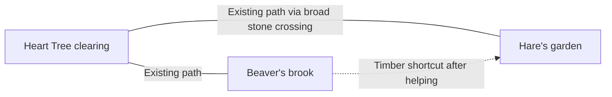

# The opening woodland — play layout and camera

> Design reference recorded during planning. Implementation and approval statements describe the stage when it was written. See the [current app notes](../../docs/HEART-TREE.md) and [design index](../README.md) for the present build.

Design specification for the [implemented first local prototype](../../../../design/archive/implementation-notes/PLAYABLE-SLICE.md). The selected visual reference is [original A, Painted woodland](ART-DIRECTION.md). Static boards remain references; device and child validation are pending.

[Opening map and three camera studies](opening-layout.png).

## 1. A small neighbourhood with a useful shortcut

Use three places: the Heart Tree clearing, Beaver's brook and Brown Hare's meadow garden. Beaver and Hare can both be reached before the quest. The bridge adds the direct connection between their places.

The two existing routes run from the tree to each neighbour. The garden route includes a broad existing stone-and-earth crossing, with water passing beneath it. It reads as continuous ground, requires ordinary walking and offers no precision or jumping challenge. The unfinished timber bridge is farther upstream, clearly distinct from this existing crossing.

Before repair, the route between neighbours goes via the tree. Afterwards, the timber crossing closes the small neighbourhood loop. Both earlier routes stay usable. The bridge restores convenience and neighbour contact; one shared request is enough.

The image illustrates the intended places and appearance. This connectivity specification governs navigation; generated linework is not construction geometry.

## 2. Place arrangement

| Place | Layout and interaction | Clear view to preserve |
| --- | --- | --- |
| Heart Tree | Lower/central clearing on the west side of the brook; fox starts with a reachable path spot ahead. Two paths lead towards the neighbours. | Fox, first path spot and a glimpse of the next landmark. Keep the oak's crown clear of the starting action. |
| Beaver's brook | Upstream west bank, at the unfinished timber crossing. A safe landing holds Beaver, fox and the request interaction. | Bridge gap, opposite landing and Hare beyond it fit together. The request bubble must not cover the missing section. |
| Hare's garden | Opposite bank, with a small wild-strawberry patch and a low hazel edge. Reachable by the existing garden route. | Hare, a clear approach and the direction back towards Beaver. Garden detail remains at the original A density. |
| Existing crossing | On the longer tree-to-garden route. Broad, finished and visually subordinate to the timber bridge. | Continuous walkable surface and clear banks. Its appearance should not suggest another unfinished project. |

Use native alder/reeds at water, beech/hazel at the edges and a pedunculate oak for the Heart Tree. Open ground remains as generous as in original A. The brook, tree bases and low vegetation create readable boundaries; decoration stays clear of approach spots.

## 3. Movement defaults

- Tap/click reachable ground to walk. A new destination replaces the previous one.
- Tap a resident to approach along a safe path and open their invitation when close. Walking nearby alone may invite a gesture, without forcing a modal conversation.
- Tapping Hare across the unfinished bridge uses the existing route through the tree clearing. The fox stays on the walkable surface.
- A water tap indicates a safe reachable point on the current bank; it never starts swimming or an attempt to jump the gap. A resident tap takes priority over ground behind the character.
- Keep paths and bridge landings broad enough for comfortable targeting. Their final dimensions need a device prototype. Draft interface controls should aim for generous touch areas, around 64–80 CSS pixels on the target tablet.
- Ground input remains separate from interface input. Pressing help, a request or a return picture must not also move the fox.
- Approaching an invitation does not require lining the fox up with a small exact point. New movement can cancel an approach before a request opens.

## 4. Camera views

Use a fixed orthographic camera, approximately 55–60 degrees down. Keep its direction steady and follow gently. The three studies on the board are views within one camera system.

| View | Composition | Behaviour |
| --- | --- | --- |
| Arrival | Fox below the oak, open ground and one obvious path spot ahead | Introduce tap-to-walk with a short gesture and spoken line. Keep other controls quiet. |
| Request | Fox and Beaver on the near bank; unfinished bridge, opposite landing and Hare visible | Settle gently when the requested interaction starts. Keep the gap visible behind any picture panel. |
| Payoff | Same brook view and bridge orientation as the request | Return beside Beaver, show the finished connection, then let normal walking carry the fox across. Preserve continuity. |

Fade a foreground canopy when it obscures the fox, destination or an important interaction. Avoid camera rotation, sudden zoom and decorative movement across the scene. The flat activity pauses unnecessary world motion and returns to the saved view.

## 5. Either neighbour can come first

Beaver offers the one opening request. If Hare is visited first, she gestures towards the same bridge and shows Beaver's picture. Tapping that picture guides the fox to Beaver along the existing route and opens his request on arrival. It does not create a second quest or skip its explanation.

If the child postpones, the forest remains available. Beaver stays at the brook and the same pictured invitation remains easy to find. Walking away has no failure state.

## 6. The wider loop and activity capacity

Keep onward connections towards the future pond and moss-grove portions of the five-place loop in the authoring layout. During the short opening, low native hazel/branch boundaries make its pocket legible. The neighbours clear those small onward boundaries as part of the completed introduction; there is no extra puzzle or gate-control task. The bridge remains the foreground payoff.

In the eventual full game, the completed introduction enables the wider loop and preserves those open routes. The first local slice only needs to demonstrate the crossing, garden greeting and onward invitation; it must not claim to contain the unbuilt rest of the forest.

Reserve room for the planned three recurring activity places per clearing, using local resident, work/book and observation spots. Only the opening request is advertised initially. Further episodes reuse those places; they do not require more map pins or trees.

## 7. Checks for the later slice

Confirm that both neighbours are reachable before repair; water and the unfinished bridge cannot trap the fox; one return leads to one durable repair; the direct route works afterwards; camera occlusion does not hide actions; and Hare-first reaches the same request. These are future interactive checks. Static artwork does not establish walkability or child comprehension.

[Opening interaction states](OPENING-INTERACTIONS.md) · [Selected-style walkthrough](painted-woodland-opening.png)
