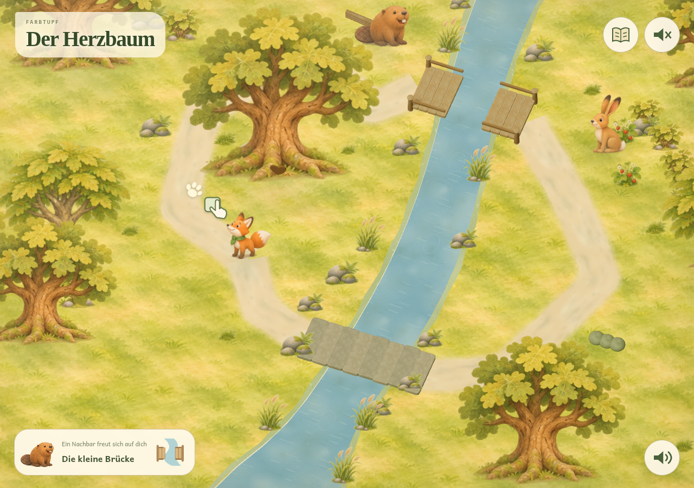

# Farbtupf design archive

The collected visualisations, design decisions, story/gameplay plans, research
and review documents are saved in this repository. Earlier alternatives are
preserved alongside the selected direction and actual implementation captures.

**Current direction:** original **A, Painted woodland**, with a Swiss-native
forest, a fox companion, short complete quests and picture-led play for a
6–7-year-old who initially cannot read. The current build uses layered painted
artwork in Three.js and matching flat puzzle artwork.

| Start here | Contents |
| --- | --- |
| [Heart Tree design pack](heart-tree/README.md) | Story, world, gameplay, non-reader guidance, opening interactions and implementation plans |
| [All Heart Tree visualisations](heart-tree/GALLERY.md) | Early options, world maps, style comparisons, storyboards, walkthroughs and app screenshots |
| [Design review PDF](heart-tree/DESIGN-REVIEW.pdf) | Illustrated story and interaction review |
| [Opening review PDF](heart-tree/OPENING-REVIEW.pdf) | Opening layout, camera, support routes and summary |
| [Picture-only walkthrough cards PDF](heart-tree/walkthrough-cards.pdf) | Pattern, quantity and memory reference cards |
| [Walkthrough overview PDF](heart-tree/walkthrough-preview.pdf) | Overview of the comprehension walkthrough |
| [Original document authoring source](heart-tree/authoring/README.md) | Sources for the review PDFs, picture cards, manifests and preview images |
| [Current app and verification notes](../docs/HEART-TREE.md) | Implemented story, controls, saving and remaining human checks |

## Selected woodland and current app

- [Chosen art direction](heart-tree/ART-DIRECTION.md)
- [Original A reference — left column of the comparison](heart-tree/visual-middle-ground-options.png)
- [Opening walkthrough in Painted woodland](heart-tree/painted-woodland-opening.png)
- [Painted world and puzzle screenshots](heart-tree/painted-implementation/README.md)
- [Production artwork and atlas notes](../assets/woodland/ART-NOTES.md)
- [Painted characters and natural objects](../assets/woodland/characters-nature.png),
  [forest plants and props](../assets/woodland/forest-props.png),
  [place illustrations](../assets/woodland/places.png) and
  [painted ground](../assets/woodland/ground.png)

## Earlier visual and interaction work

| Collection | Contents |
| --- | --- |
| [Five initial visual identities](mockups/README.md) | Waldatelier, Formenfreude, Papierwelt, Kleine Welten and Tintenabenteuer; original generation briefs and review page |
| [Waldatelier implementation](waldatelier/README.md) | Original artwork briefs, icon source, app screenshots and visual verification |
| [Waldentdeckungen puzzle work](waldentdeckungen/README.md) | Memory, mirror-grid and picture-chart designs and screenshots |
| [Early forest story/gameplay options](heart-tree/early-options/README.md) | All recovered story, world-layout, progression, opening and quest-option boards |
| [Additional app captures](verification/README.md) | Retained implementation, responsive, timer and browser-check screenshots |

## Learning, research and supporting documents

- [Learning concept](../docs/LEARNING.md)
- [Learning ideas document](../docs/lernideen.html)
- [Curriculum and handwriting research](../docs/RESEARCH.md)
- [LMVZ and publisher research](../docs/LMVZ-RESEARCH.md)
- [Resource research and activity mapping](../docs/RESOURCE-RESEARCH.md)
- [Timer behaviour](../docs/TIMER.md)
- [Preview and deployment notes](../docs/PREVIEW.md)

## Archive provenance

[The archive manifest](archive-manifest.json) maps every file from the local
Heart Tree design pack and every generated image original to its repository
location, with SHA-256 hashes. Identical images share a stored file. Original
PNG/PDF files are preserved; Markdown links were converted for GitHub browsing.

Historical plans and screenshots describe earlier stages. Current implementation
status lives in the [app notes](../docs/HEART-TREE.md). Automated captures are not
child observations; physical iPad/Safari and non-reader observation remain the
human checks already recorded there.

[Back to the app README](../README.md)
