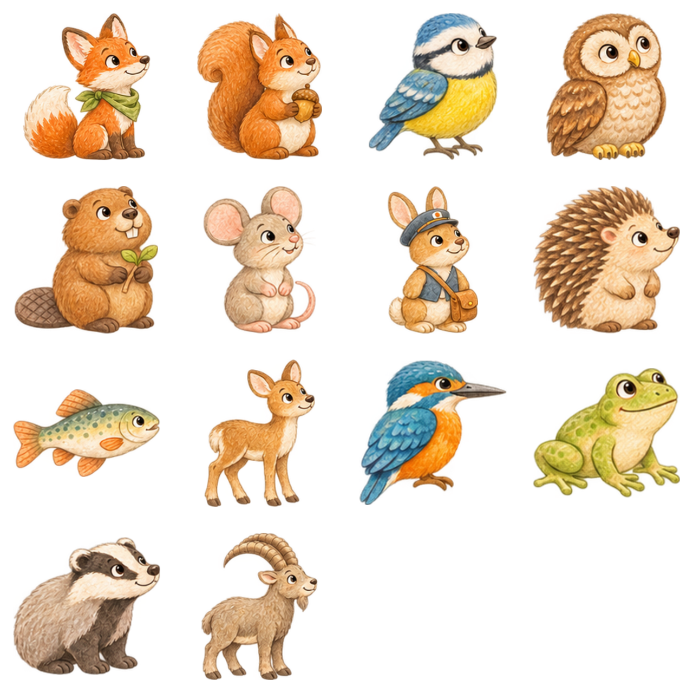

# Painted friends on invitation letters

Letters show the sender in the canonical watercolour-and-coloured-pencil style. Use `FK.friendsArt.letterPortrait(id)`; the letter renderer adds the accessible sender name. Model portraits still identify friends in the live world, map, puzzle context, companions and celebration.



The atlas has four columns and four rows, with 320 px cells. Order is fixed:

| Row | First | Second | Third | Fourth |
| --- | --- | --- | --- | --- |
| 1 | Fuchs (`fox`) | Eichhörnchen (`squirrel`) | Blaumeise (`bird`) | Waldkauz (`owl`) |
| 2 | Biber (`beaver`) | Maus (`mouse`) | Briefträger (`mailman`) | Igel (`hedgehog`) |
| 3 | Fisch (`fish`) | Reh (`deer`) | Eisvogel (`kingfisher`) | Frosch (`frog`) |
| 4 | Dachs (`badger`) | Steinbock (`ibex`) | Empty | Empty |

Steinbock is included as an available painted friend. This art change does not add a new puzzle, letter destination or journey rule.

Run `node tools/illustrations/style.cjs --request letter-friends`. Attach the canonical animal and object references first. The model atlas supplies only identity/colour/accessories; do not copy its plush material, proportions, lighting or render style. Keep all fourteen friends in the same drawing technique, with complete silhouettes and real alpha.

The [preparation manifest](letter-friends.json) fixes row order, source/output paths and actual generation provenance. If subjects touch cell boundaries, use the registered `layout-repair` request with the current output appended after the canonical pair, explicitly retaining the same fourteen animals and two empty cells. Recenter/shrink before packing; never trim ears, tails or horns to force a fit.

```sh
node tools/illustrations/pack-atlas.cjs design/artwork/letter-friends.json
node tools/illustrations/style.cjs --check
```

Inspect every portrait against cream and transparent backgrounds, then the actual invitation at phone, tablet and landscape sizes. Preserve model portraits and existing journeys/saves.
