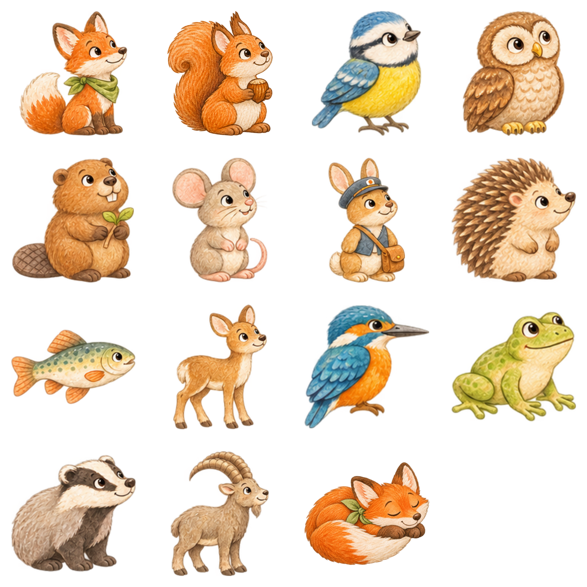

# Shared painted character portraits

The same watercolour-and-coloured-pencil cast now appears on invitation letters, puzzle screens, map pins, menus, review/gallery cards, companions and celebrations. Use `FK.friendsArt.portrait(id)`; letters retain the `letterPortrait(id)` API and add the accessible sender name. Only the freely explorable world and den fox use live 3D models.



The atlas has four columns and four rows, with 320 px cells. Order is fixed:

| Row | First | Second | Third | Fourth |
| --- | --- | --- | --- | --- |
| 1 | Fuchs (`fox`) | Eichhörnchen (`squirrel`) | Blaumeise (`bird`) | Waldkauz (`owl`) |
| 2 | Biber (`beaver`) | Maus (`mouse`) | Briefträger (`mailman`) | Igel (`hedgehog`) |
| 3 | Fisch (`fish`) | Reh (`deer`) | Eisvogel (`kingfisher`) | Frosch (`frog`) |
| 4 | Dachs (`badger`) | Steinbock (`ibex`) | Sleeping Fuchs (`fox-sleep`) | Empty |

Steinbock has a named, clickable map pin routing to his existing world location. He remains a non-puzzle neighbour; this art change adds no puzzle or letter assignment.

Run `node tools/illustrations/style.cjs --request friend-portraits`. Attach the canonical animal and object references first. The existing painted atlas supplies identities and accessories; the canonical references define medium. Keep all fourteen friends and the sleeping fox in the same drawing technique, with complete silhouettes and real alpha.

The [preparation manifest](friend-portraits.json) fixes row order, source/output paths and actual generation provenance. If subjects touch cell boundaries, use the registered `layout-repair` request with the current output appended after the canonical pair, explicitly retaining the same fourteen friends plus sleeping fox and one empty cell. Recenter/shrink before packing; never trim ears, tails or horns to force a fit.

```sh
node tools/illustrations/pack-atlas.cjs design/artwork/friend-portraits.json
node tools/illustrations/style.cjs --check
```

Inspect every portrait against cream and transparent backgrounds, then the actual invitation at phone, tablet and landscape sizes. Preserve live world models and existing journeys/saves.

The current source was mechanically composed from the already approved fourteen-friend base and a new matching sleeping-fox pose. The [generation/composition record](generation-records/friend-portraits.json) preserves those inputs and hashes. The original fourteen-friend source/output is retained as a preparation input, not a runtime dependency.
