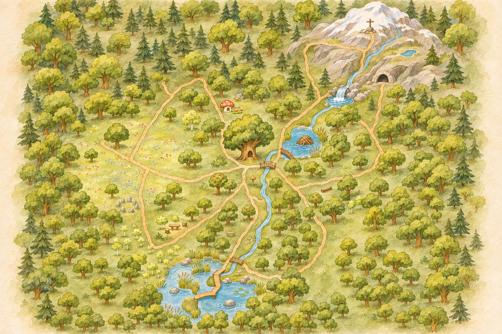

# Current design proposals

These are review images, outside runtime imports, CSS, the offline cache and the published game. A proposal does not authorize implementation.

## Drawn woodland map — version 1

Requested 16 November 2026 as a draft only. The painting uses the [canonical watercolour/pencil style](../../illustrations/STYLE.md), with the current map supplied for geography/composition only. It retains the mountain, descending stream, waterfall pool, beaver pond, central bridge/home tree, western flower meadow and southern wetland in their recognizable relative positions. It is a visual proposal, not a surveyed coordinate layer; approval would be followed by landmark/pin alignment against the real world.

- [Complete current forward prompt](../prompts/drawn-map-draft.txt).
- [Actual generation request, ordered references and source hash](../generation-records/drawn-map-draft.json).
- The runtime still uses [world-map.webp](../../../assets/forest-friends/world-map.webp), generated by [tools/map](../../../tools/map/README.md). No runtime map pixels or pin locations changed.

## Letter friends — retained preparation output

[The initial fourteen-friend output](letter-friends-initial.png) is retained solely as the content/layout input for a spacing correction. Some animals touched cell boundaries; it is not the runtime atlas and does not define a competing style. The [initial generation record](../generation-records/letter-friends-initial.json) preserves exactly what was requested. Future requests always use the canonical style and the current `letter-friends` prompt.
