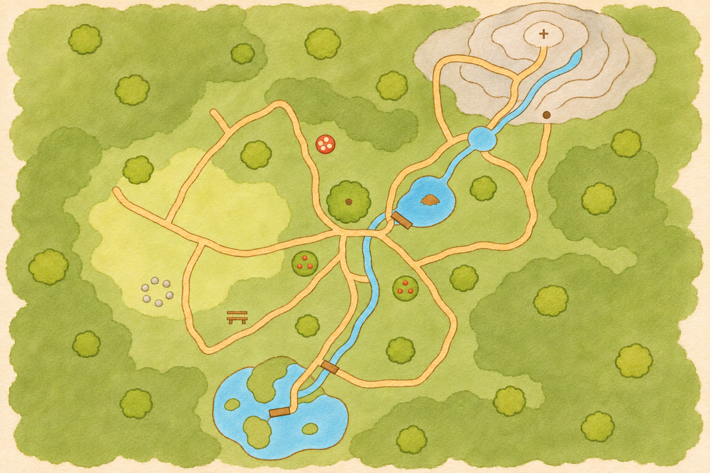

# Current design proposals

These are review images, outside runtime imports, CSS, the offline cache and the published game. A proposal does not authorize implementation.

## Drawn woodland map — version 2: simplified top-down plan

Requested 16 November 2026 as a draft only, then revised to be more like a real map: fewer details, flat two-dimensional shapes and a strictly top-down plan view. The painting uses the [canonical watercolour/pencil style](../../illustrations/STYLE.md) with the dedicated `cartography` role. Broad woodland/meadow regions, clear water and continuous paths carry the geography. Sparse canopy/landmark symbols replace tiny scenery; mountain elevation uses contour lines instead of a side-view peak. No visible tree trunks, building facades, relief or cast shadows.

The current map and previous draft supply geography/composition only. Recognizable anchors remain the mountain, descending stream, upper pool, beaver pond, central crossing/home tree, western meadow and southern lake. This is a visual proposal, not a surveyed coordinate layer; approval would be followed by landmark/pin alignment against the real world.

- [Complete current forward prompt](../prompts/drawn-map-draft.txt).
- [Actual version 2 generation request, ordered references and source hash](../generation-records/drawn-map-draft-v2.json).
- The runtime still uses [world-map.webp](../../../assets/forest-friends/world-map.webp), generated by [tools/map](../../../tools/map/README.md). No runtime map pixels or pin locations changed.

[Version 1](drawn-map-v1.png) and its [actual request](../generation-records/drawn-map-draft.json) are retained as the superseded proposal. Its scenic/oblique treatment is not a forward style or projection reference. Future map requests use the current `cartography` role and complete prompt.

The [initial version 2 preparation output](preparation/drawn-map-v2-initial.png) and [actual request](../generation-records/drawn-map-draft-v2-initial.json) are retained only to explain the final correction of a few remaining side-view landmark symbols. The current proposal is the final version 2 image above.

## Letter friends — retained preparation output

[The initial fourteen-friend output](letter-friends-initial.png) is retained solely as the content/layout input for a spacing correction. Some animals touched cell boundaries; it is not the runtime atlas and does not define a competing style. The [initial generation record](../generation-records/letter-friends-initial.json) preserves exactly what was requested. Future requests always use the canonical style and the current `letter-friends` prompt.
