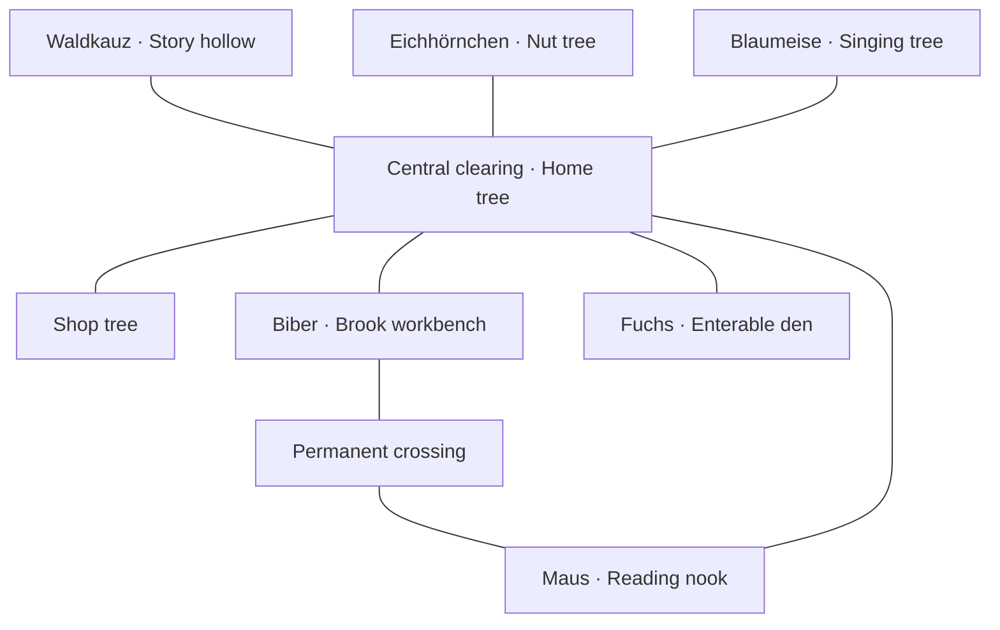

# First-session and interaction design

**Status:** Working proposal, 7 November 2026. This document resolves routine design details for review; it is not a record of child testing. Character references use Swiss Standard German. See [puzzle specifications](puzzle-specifications.md).

## First playable scope

Include Fuchs, Eichhörnchen, Blaumeise, Waldkauz, Biber and Maus. Bringing Maus into the first playable version gives early reading a place alongside numeracy and listening. Other characters retain the shared competency assignments in the blueprint and enter later. No old story repairs or chapter requirements are needed to access the first five puzzles.

The opening suggestion leads to Eichhörnchen, but all five friends are freely reachable. A shop counter runs without an additional shopkeeper model for this first version; its permanent owner remains undecided. Basic bed, table and door are available from the start. Buying a furnishing is an invitation, not a gate to further learning.

## World layout

This is a topology sketch, not a scaled terrain plan. All marked paths are accessible from the start. The brook has a safe permanent crossing; Biber's repeatable construction activity cannot block travel.

Keep a short clear route from the den to each first friend. The loop through the brook and reading nook offers exploration without forcing a long walk between tasks. Mountain, cave, swamp and deep mist remain visible future regions outside the first playable boundary.

Movement proposal: tap/click ground to walk; optional existing keyboard/stick controls remain. Use an elevated following camera with gentle smoothing, no automatic spin and no precision platforming. Trees fade where they hide Fuchs or the destination. When blocked, move to a reachable point and give a gentle route cue. Selecting a friend on the map sets a marker and arrow; it does not teleport. Proximity shows the friend's picture and a large interaction button. Test camera comfort and travel distance with children before fixing numeric values.

[Emberwick](https://simonw.github.io/emberwick/v11/emberwick.html) exposes click-to-walk, keyboard walking and enterable places. Those controls inform the proposal; camera feel still needs an interactive comparison. This source inspection does not establish touch usability.

## First-session storyboard

| Scene | What the child sees and does | Spoken/UI text | Save and failure behaviour |
| --- | --- | --- | --- |
| 1. Wake at home | Fuchs stretches near bed; table, empty furnishing spot and door are visible | «Das ist dein Zuhause. Draussen warten deine Freunde.» | Create or restore save; never reset an existing furnished den. |
| 2. Choose an action | Tap table, bed, bag or door; first suggestion gently indicates door | Door: «Nach draussen» | Exploring home is optional; audio starts after interaction when required by the browser. |
| 3. Walk outside | Central tree and nut-tree landmark are visible; a short pawprint cue suggests Eichhörnchen | «Eichhörnchen sammelt Nüsse. Möchtest du helfen?» | Any friend can be chosen; a missed cue can be replayed. |
| 4. Meet | Eichhörnchen gestures to a basket; accept or keep exploring | Buttons: «Helfen», «Später» | No round starts or reward changes until accepted. |
| 5. Learn and play | Example, then five tasks with replay, hint, check and leave controls | «Wie viele Nüsse sind hier?» | Wrong answers remain editable. Leaving saves the exact task. |
| 6. Thank and reward | Eichhörnchen thanks Fuchs; three nut icons move into the bag | «Danke! Diese Nüsse sind für dich.» | Grant once even if refreshed during the animation. |
| 7. Choose next | Return to the same world position; shop suggestion appears | «Im Laden gibt es etwas für dein Zuhause.» | Friend/map/home remain available; no forced shop visit. |
| 8. Buy | Preview a cushion, picture price and current wallet; confirm or cancel | «Kissen», «2 Nüsse», «Kaufen» | Cancel spends nothing. Insufficient resources keep the preview open. |
| 9. Make a home | Return through the den door; choose a valid placement spot for the cushion | «Wohin möchtest du das Kissen legen?» | Confirmed placement survives refresh; invalid placement retains the prior position. |
| 10. Continue or pause | Other friends remain available; bed is optional pretend play | «Bis bald!» when leaving | Closing/reopening preserves state. No daily streak or upkeep demand. |

The guided route is optional. A returning player starts in the den and can resume a saved puzzle through a pictured invitation, preserving the original round. Exiting a puzzle normally returns to its host.

## Screen wireframes

These describe layout and hierarchy for the next visual mockup, not final artwork.

| Screen | Top strip | Main area | Bottom controls |
| --- | --- | --- | --- |
| Den | Home label; resource bag; adult settings | Bed, drawing table, placed furnishings, clear exit; camera never hides interactive objects | Home actions appear beside the selected object; furnishing tray only in arrangement mode |
| Forest | Picture map; resource bag; small home shortcut that sets a route | Fuchs and navigable world; arrow/pawprints to chosen friend | Large contextual talk/enter button near destination; no permanent task text over the scenery |
| Friend invitation | Friend portrait and name; close | Short acted request and puzzle preview picture | Help / later |
| Puzzle | Host portrait; five progress dots; leave | One clear task scene; choices close to objects | Replay instruction; example; hint; undo when relevant; check; next after feedback |
| Shop | Bag and close | Item grid, selected item preview, pictured price and owned quantity | Buy/cancel; no purchase on preview tap |
| Arrangement | Close/cancel | Den with visible valid placement spots | Owned-item tray, move, confirm and remove-to-inventory |
| Adult settings | Back | Audio controls; save/log tools; local logging explanation | Export log; clear log with confirmation; deliberate reset kept separate |

Aim for at least 48 CSS-pixel touch areas and generous spacing; this is a design target to validate on an actual iPad. Never require dragging alone. Use shape and position as well as colour, legible text, pictured controls with repeatable labels, and reduced-motion behaviour. Keep the task and check button visible without horizontal scrolling. Pause task timing when the app is hidden or the child leaves.

## Character and audio direction for the first asset pass

| Character | Model and motion priorities | Expression / spoken delivery |
| --- | --- | --- |
| Fuchs | Orange/cream coat, green neckerchief, full tail; walk, stop, turn, sit, sleep, eat, drink and greet | Curious, gentle movements; readable from the following camera |
| Waldkauz | Brown rounded body, visible wings, large eyes; blink, head tilt, consult pictures, relieved nod | Warm, thoughtful and occasionally muddled; never a caricature of incapacity |
| Eichhörnchen | Red coat, tufted ears, curling tail; collect and count nut gestures | Prepared and appreciative |
| Blaumeise | Blue/yellow silhouette; perch, hop, sing, short wing movements | Clear spoken labels before musical reward; no music masking speech sounds |
| Biber | Broad tail, sturdy body; carry piece, inspect plan, place piece | Practical and affectionate |
| Maus | Small body, large ears; point to word, look between pictures, delighted nod | Learns with the child; does not model deliberate wrong pronunciations |

The [first visual review](visuals/README.md) now includes a Fuchs/Waldkauz reference sheet, den and forest scene concepts, and editable counting/reading/shop screen specimens. These are review proposals; production models, animation and final assets remain to be made. Reuse or adapt existing models only after inspecting their quality and licences.

Use quiet music in the den and forest, local water/wind/bird ambience and short reward sounds. Duck music and ambience during speech; suppress unrelated bird calls during rhyming tasks. Separate remembered music, ambience and speech controls. Avoid an endless reward fanfare or loud incorrect-answer sound.

## Review script

Ask a Zürich teacher to check each initial task and prerequisite. In a supervised child walkthrough, observe whether the child can leave the den, find a friend, understand the example, correct a mistake, request help, resume an interrupted task, buy and place an item, and find a second activity. Record observations instead of treating prototype success as curriculum mastery.

Open design questions after the walkthrough: camera comfort, travel distance, illustration naming, comprehension of the bag/price icons, reading word pool, and whether three reward resources per round feels useful without overpowering learning. No child testing has yet been performed.
