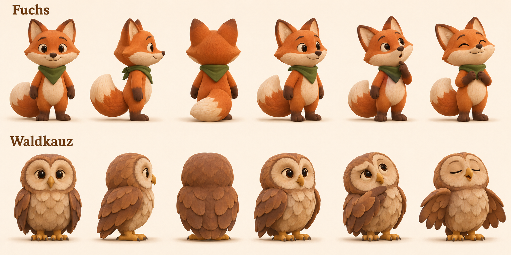
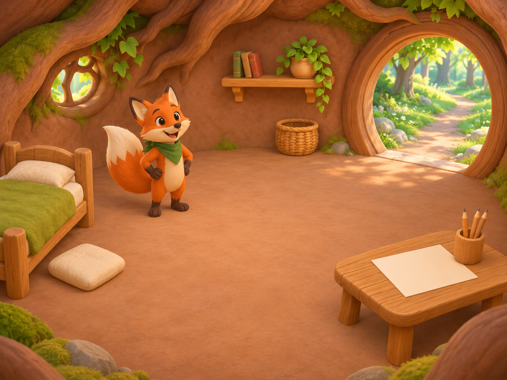
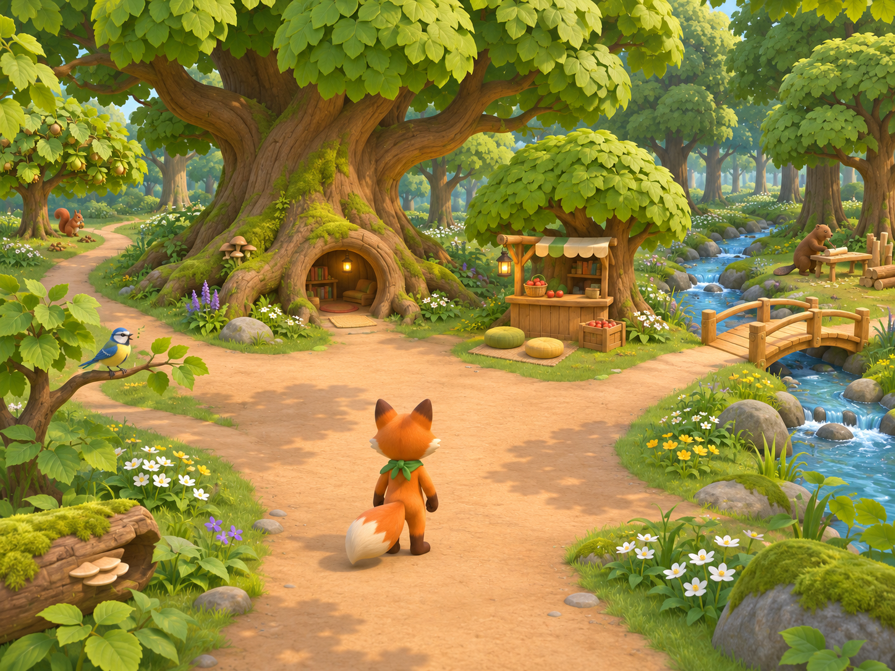

> Current working review: [review-v5.html](review-v5.html). See [revision-5 decisions](revisions/v5.md). Earlier versions remain preserved.

# Visual design review — version 2

**Status:** Character and den direction endorsed by the user on 7 November 2026. Version 2 revises navigation for children who cannot yet read; child usability and curriculum review remain outstanding.

The visual pass is preserved as a development comparison baseline: see [baseline.md](baseline.md), [frozen version 2](review-v2.html), [previous version 1](review-v1.html) and the [reference screenshots](baselines/v2). Do not overwrite these references during development.

Open [the interactive review](review.html) in a browser. It contains six views: Zuhause, Wald, Zählen, Lesen, Laden and Figuren. The layout and text are editable in the HTML file. It can also be served locally from the repository root using `python3 -m http.server 8766 --bind 127.0.0.1`, then opened at `http://127.0.0.1:8766/design/forest-friends/visuals/review.html`.

Use a separate local port from the installed game's preview: an existing service worker on the game's origin can return an older cached design. The review itself registers no service worker and writes no save data.

## Character reference

Fuchs has an orange/cream coat, dark paws, a cream-tipped tail and green neckerchief. Waldkauz has rounded tawny feathers, facial discs, large warm eyes and no ear tufts. The sheet establishes silhouettes and expressions for review, not final mesh topology, rigging, animation or textures.

Model handoff: keep Fuchs's tail and neckerchief readable from behind; preserve Waldkauz's distinct facial discs and independently movable wings. Use simplified broad material shapes in real-time models. The image's feather/fur detail is a mood reference, not a requirement to reproduce dense geometry on tablets. Compare front/side/back views during modelling rather than treating a generated turnaround as exact orthographic construction.

## Home and forest reference

The door, drawing table, bed and open floor are the home menu. The generated scene includes starter bedding and a plain cushion; these are background dressing, not the purchased ochre cushion represented in the interaction specimen. In production, separate every movable or buyable furnishing from the environment so ownership and placement are accurately represented.

The central tree is the home landmark, the smaller tree is the shop, and broad sandy paths lead towards neighbours. The sample world is an illustration; it does not demonstrate the 3D camera, collision, routing or reachability of any location. The two sample friend buttons switch between design views and are not literal map coordinates. The topology in [experience design](../experience-design.md) remains the world-layout reference.

## Picture-led interface

Within the game frame, actions use objects and pictures with repeatable spoken guidance. Reading is required only for the actual reading task. Numerals remain in the counting task and inventory quantities. Written headings and review notes outside the frame are for adults; review notes are collapsed by default.

- **Zuhause:** tap the doorway to leave, the drawing table to draw and the bed to rest. A bought cushion appears as a pictured placement suggestion. The original den art is unchanged.
- **Wald:** neighbours appear as portraits and places as recognisable scene objects. The picture map selects a destination and shows a direction cue; it does not teleport directly into a puzzle.
- **Zählen:** seven selectable nuts, three numeral choices and a pictured check. Wrong answers get a retry marker and spoken encouragement. Help is spoken; the worked example uses a separate group of three nuts and a pointing hand.
- **Lesen:** «Maus» is the only visible word in the task. Directions are spoken; the separate example demonstrates «Ast». The scored target is not automatically pronounced. Descriptive accessibility labels remain available; the accessible reading variant still needs review because labels can reveal a picture match.
- **Laden:** item pictures, actual nut tokens for prices and available resources, an exchange arrow and explicit check-to-buy. Owned furniture uses a check badge; consumables show quantity. No product description must be read.
- **Beutel:** pictured wallet and belongings; tap an apple to eat it at home or a cushion to return home for placement.
- **Figuren:** original Fuchs/Waldkauz reference sheet.

Controls have accessible German names and keyboard focus. The speaker repeats contextual guidance; the hand shows a separate example; the Waldkauz help picture supplies a spoken clue. These symbols still need child testing. Production onboarding must demonstrate unfamiliar symbols, not assume that removing words makes them understandable.

The five progress dots show the planned round structure, but there is only one specimen task for counting and reading. The review includes a small disposable drawing surface and a cosmetic rest effect; they are not production features. Furniture uses one fixed placement spot. Speech uses an available browser voice; audio quality and first-use narration on a physical tablet remain unvalidated. Sample progress resets on refresh; the real game's durable-save requirement remains unchanged.

## Browser review performed

Checked the picture-led review at 1024 × 900 and 390 × 844 viewports. Saved fixed screenshots of home, forest, map, counting, its separate demonstration, reading, shop and compact counting. Confirmed counting and reading wrong-answer correction, separate demonstration content, picture-map route selection, cushion/apple purchases, ownership/balance changes, placement, pictured inventory and consumption. Opened the drawing surface and inspected its controls. Compact counting has no horizontal overflow and a minimum game-control dimension of 48 CSS pixels.

This checks the prototype, not physical iPad performance, narration quality, child comprehension or curriculum attainment. Version 1 browser observations remain in the original Git history. Version 2 reference screenshots and file hashes are preserved for later comparison.

## Review questions and remaining work

| Review topic | Concrete question | What to record |
| --- | --- | --- |
| Character identity | Are Fuchs and Waldkauz recognisable, expressive and appropriate for first grade? | Specific silhouette, expression or costume changes |
| Home clarity | Can the child find the door, table and furnishing action from the image? | First action and any spoken help needed |
| Counting | Does the child understand the five/ten arrangement and the check button? | Marks, corrections and requested help; no inferred mental strategy |
| Reading | Are the word, pictures and instructions understandable without speaking the answer? | Introduced letters, picture naming and use of help |
| Rewards | Can the child explain the cushion price and tell ownership from apple quantity? | Misunderstandings and useful icon changes |
| World movement | What camera and travel behaviour makes the forest feel comfortable? | Requires a later 3D movement prototype; a still image is insufficient |

Next art work after feedback: individual character references for Eichhörnchen, Blaumeise, Biber and Maus; a geometry workbench; rhyme and story screens; an illustrated map; and approved resource/item icon families. Next content work: expand the five task pools, complete teacher review and record a child walkthrough. Do not freeze design from artwork alone.

## Source and generation record

The three PNGs were created with the built-in image_gen tool. Full final prompts are saved in [prompts.json](prompts.json); no external image references were supplied. Files are project-local and versioned, and no existing game art was overwritten. Screen controls, small SVG illustrations and layout were authored directly for this review; they are not generated screenshots.

| File | Purpose |
| --- | --- |
| characters-v1.png | Fuchs/Waldkauz model and expression reference |
| den-v1.png | Home scene concept |
| forest-v1.png | Central clearing and world scene concept |
| review.html | Current editable picture-led review |
| review-v1.html | Frozen original text-heavy interface |
| review-v2.html | Frozen picture-led interface |
| baseline.md | Development comparison rules and acceptance rubric |
| baseline-manifest.json | Integrity record for frozen reference files |
| baselines/v2 | Fixed browser screenshots |
| prompts.json | Exact generation prompt set and tool provenance |
