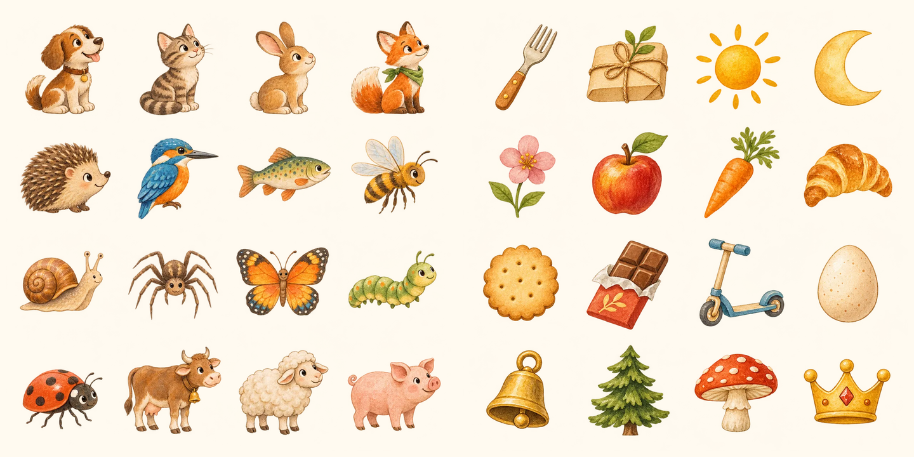

# Waldpost illustration style

**Canonical style ID: `waldpost-watercolour-pencil-v1`.** This is the single authority for every new image-generator request. It preserves the predominant style of the 235-picture gallery after the November 2026 consistency correction.

## The drawing

Warm children's picture-book **watercolour finished with visible coloured-pencil strokes**. Light uneven washes, organic sepia contours, delicate hatching, softly irregular edges and modest drawn shading. Keep the image visibly handmade, matte and friendly. Paper grain belongs within the painted subject; it is not an opaque rectangle behind a transparent asset.

Use cream, honey brown, restrained sage and blue as the general palette. Exact task colours take priority: a red answer stays red, white stays distinguishable from yellow, and blue stays distinguishable from violet. Preserve believable anatomy, species markings, one counted item per object and unmistakable action differences.

The fixed references are [animals.png](references/watercolour-pencil-v1/animals.png) and [objects.png](references/watercolour-pencil-v1/objects.png), copied from the majority `animals` and `words-two` drawings. Their SHA-256 values are locked in [style.json](style.json). Attach their actual pixels to the image service. Runtime filenames, old prompts and style adjectives alone do not supply a reference image.

Avoid sculpted/plush/felt/clay finishes, rendered or photographic material detail, glossy modelling, inflated forms, heavy bump texture, studio lighting and deep ambient-occlusion shadows. Historical style boards and superseded images are records, not alternative directions.

## Apply the same style by role

| Role | Required treatment |
| --- | --- |
| Learning subjects | Fine organic pencil contours and light watercolour; complete recognizable subjects in transparent square cells, with generous clean gutters |
| Navigation symbols | The approved simpler application: broad sepia outline, bold silhouette, nearly flat warm fills, very little detail, readable at 32 px; use the current symbol sheet as an additional simplicity reference |
| Stationery | Pale cream paper with restrained pencil borders/leaf details; transparent perimeter and empty space for the separately painted sender |
| Letter sender portraits | The same watercolour/pencil animal drawing as the canonical references, with recognizable species/markings/accessories; isolated complete animals in transparent square cells. Use the `letter-friends` request, including Steinbock |
| Background paintings | The same watercolour/pencil medium at scene scale; quiet pale washes, restrained edge detail and preserved camera/layout anchors; opaque canvas |
| App emblem | Simple, readable illustrated branding in the same palette and technique |

Puzzle/map/companion portraits and the real-time world keep their existing code/model pipelines. Invitation letters use the explicitly painted sender role through `FK.friendsArt.letterPortrait`, rather than the model atlas. Exact geometry, routes and handwriting remain authored paths. Preserve existing den/door pictures by reuse unless the user specifically asks to change them. Navigation back is a simple flat illustrated arrow matching the map, letter and settings symbols. These role boundaries are prescribed parts of the design, not a menu of competing styles.

## Make a request

1. Reuse a picture from the [central library](../../assets/waldatelier/README.md) whenever it already fits.
2. Choose a registered prompt in [style.json](style.json). Run `node tools/illustrations/style.cjs --request <id>` from the repository root.
3. Pass the returned **complete prompt, actual reference-image paths and transparency flag** to an image-capable service. The tool prepares a request; it does not generate images or supply a hosted model/API key. If the environment cannot generate images, report that limitation and continue with existing art/brief preparation.
4. For an edit, append the current target after the canonical references and treat it as content/composition only. Never substitute a historical image for the first two style references. Repair prompts retain the same style block.
5. Inspect the result beside the canonical references on cream and transparency checkerboard, then in the actual phone/tablet puzzle. Check anatomy, exact quantities/colours, action differences, cell order, complete edges and real alpha. Packing cannot fix semantic drawing errors.
6. Retain the actual request, supplied reference list, generator/date, editable output, hash and packing manifest. Use the existing preparation tools and normal puzzle review rules.

All files under the active `prompts/` directories are generated from [STYLE.txt](STYLE.txt), the registered role and a subject/layout brief. Briefs are not standalone prompts. After editing a brief run `node tools/illustrations/style.cjs`, then `node tools/illustrations/style.cjs --check`. CI rejects missing/changed shared style text, unregistered prompts, altered reference pixels and historical generation inputs.

A new visual direction requires updating this contract, its versioned references and every generated prompt together. An explicit user instruction authorizes that work; do not request another confirmation for the same decision.

## History and sources

Old guides, alternative styles, generation requests, drafts, before images, comparisons and dated evidence are preserved in the [historical snapshot](../../archive/design-history/2026-11-16-before-style-contract/README.md). Original requests remain byte-exact records. They are deliberately absent from the active prompt folders.

Current final PNGs and preparation manifests remain in the design area. Their `generationRecord` points either to the archived account of an existing image or a retained new request in `design/artwork/generation-records/`; their `forwardPrompt` points to the current style-complete request for future work. New records retain the full actual request, ordered references and source hashes. A source record never overrides this style contract.
